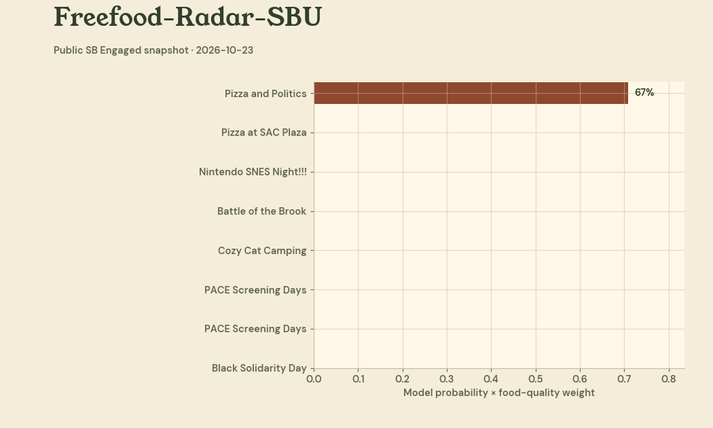

# Free Food Radar

[](tests/)
[](models/metrics.json)
[](LICENSE)
[](pyproject.toml)

Free pizza, SAC lobby, 5 PM today. That's the whole pitch.

Every week, Stony Brook clubs post dozens of events. A good fraction of them mention free food — pizza at the GBM, boba at the premiere night, biryani at the community dinner. The problem is finding them. Announcements scatter across SB Engaged, club Instagrams, and Discord servers, and nobody reads all three.

Free Food Radar reads them for you. It scrapes public campus sources, scores every event blurb with a trained NLP classifier, ranks the hits by expected value, and publishes a daily digest with a campus map. Set a watchlist for your favorite foods and it flags matches.

## Live interactive demo

[](https://faiyazenayet.github.io/freefood-radar/docs/dashboard.html)

**[Open the interactive dashboard](https://faiyazenayet.github.io/freefood-radar/docs/dashboard.html).** Campus map with today's pins, the confidence-ranked digest, classifier report cards, and historical analytics. One self-contained HTML file, no server needed. The animation above tours the same panels, rendered by `scripts/make_demo_gif.py`.

## How it works

```mermaid
flowchart LR
    A[Public sources<br/>SB Engaged · Instagram · Discord] --> B[Scrapers<br/>polite, robots.txt aware]
    B --> C[Event candidates]
    C --> D[NLP classifier<br/>TF-IDF + logistic regression<br/>Platt-calibrated]
    D --> E[Expected-value ranker<br/>P(food) x food quality]
    E --> F[Daily digest<br/>+ campus map]
    E --> G[Watchlist alerts]
    C --> H[Historical analytics<br/>top clubs · best days/times]
```

**Scrapers.** Three public-source scrapers, all polite: they check robots.txt, throttle requests, and never touch login-gated pages. SB Engaged (CampusGroups) for the club event listing, Discord's public widget JSON for server announcements, and Instagram's public post metadata. Each returns normalized `Event` objects.

**Classifier.** The quant core. A TF-IDF (1-2 grams) plus logistic regression pipeline, trained on 160 hand-labeled SBU-style event blurbs — 80 free-food mentions, 80 tricky negatives like food drives, potlucks, and "food for thought." Platt scaling calibrates the probabilities, so a 0.8 means food four times out of five. Held-out test results: **87.5% accuracy, 89.5% precision, 85.0% recall** (40 test examples, seed 7).

**Expected-value ranking.** A raw probability doesn't tell you whether it's worth the walk. Each hit also gets a food-quality score from transparent keyword weights — pizza and biryani outrank "light refreshments" — and the digest ranks by `P(food) x quality`. On the demo week, 48 candidates became 28 ranked hits.

**Watchlist.** Keep a list of favorite foods (`pizza`, `boba`, `tacos`...). Every scored event mentioning one becomes an alert. Ten alerts fired on the demo week for the default list.

**Analytics.** Which clubs feed people most, and when. The demo data says evenings are the hot zone and Monday/Wednesday/Thursday/Friday lead the week.

## Run it

```bash
python -m venv .venv && .venv/bin/pip install -r requirements.txt

# Train the classifier (writes models/classifier.joblib + metrics)
PYTHONPATH=src .venv/bin/python scripts/train_classifier.py

# Build today's digest from the event set
PYTHONPATH=src .venv/bin/python scripts/build_digest.py

# Rebuild the dashboard and the demo GIF
PYTHONPATH=src .venv/bin/python scripts/make_dashboard.py
PYTHONPATH=src .venv/bin/python scripts/make_demo_gif.py

# Tests
PYTHONPATH=src .venv/bin/python -m pytest tests/ -q
```

## Project layout

- `src/radar/scrapers/` — `corq.py` (SB Engaged), `discord.py` (widget JSON), `instagram.py` (public posts), `base.py` (polite fetching)
- `src/radar/classifier.py` — training, calibration, evaluation
- `src/radar/features.py` — food-quality weights and expected value
- `src/radar/digest.py` — ranking + markdown digest
- `src/radar/stats.py` — historical analytics
- `src/radar/watchlist.py` — favorite-food alerts
- `data/labeled.csv` — 160 hand-labeled training examples
- `data/seed_events.json` — 48 realistic SBU events for the demo
- `data/campus_places.json` — approximate building coordinates for the map
- `scripts/` — `train_classifier.py`, `build_digest.py`, `make_dashboard.py`, `make_demo_gif.py`, `make_labeled.py`, `make_seed.py`
- `tests/` — 22 tests: classifier metrics, scraper fixtures, digest, stats, watchlist
- `docs/dashboard.html` — the interactive dashboard, one self-contained file

## Limitations

- The demo digest runs on a seeded set of 48 realistic SBU events, not a live scrape: SB Engaged's event listing sits behind login from this environment, Instagram's public pages need a session, and Discord's widget only works for servers with it enabled. The scraper code is real and tested against fixtures — point it at reachable sources and the pipeline runs unchanged.
- The classifier trains on 160 hand-labeled examples. That's enough for a strong demo (89.5% precision) but a production version wants thousands of real labeled blurbs and periodic retraining as club language drifts.
- Campus map coordinates are approximate, good enough to find the building, not the room.
- The watchlist matches keywords; it doesn't understand negations yet ("no pizza, just salad" would still alert).
